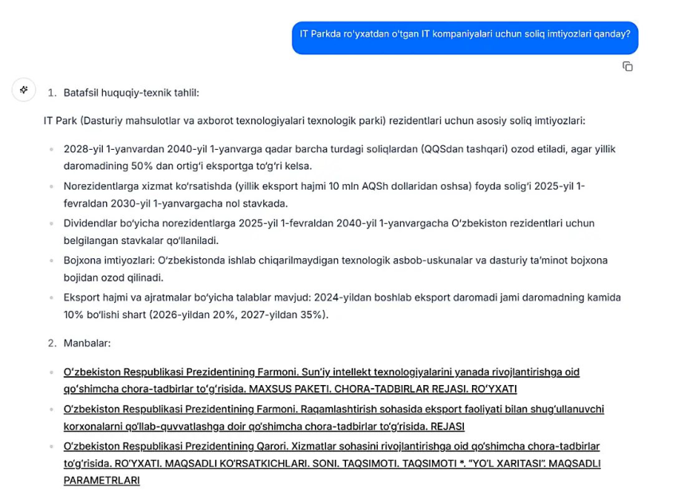

# Wakil AI: Multilingual Legal Assistant for Uzbekistan

Wakil AI is a multilingual legal assistant and lawyer marketplace designed to help people and organizations in Uzbekistan find clear, source-grounded legal guidance and professional support.

## Executive Summary

Wakil AI brings together an AI legal assistant and access to legal professionals for individuals, businesses and lawyers in Uzbekistan. The project addresses difficult-to-interpret legal texts, official sources that can be hard to navigate, and barriers to finding or affording professional help. The project brief describes the core product as production-ready; Wakil AI Associate, a private assistant for ongoing legal casework, is described separately as rolling out through limited early-access invitations. [PDF p. 1](http://localhost:3344/workspaces/ab6b13a5-514c-4849-96d2-cd4008c5c310/documents/73956dc4-bd5f-405b-8c4f-45c02c81c18e/evidence/f670158d-0e5c-47d1-ab21-1285e09c430a/asset) [PDF p. 1](http://localhost:3344/workspaces/ab6b13a5-514c-4849-96d2-cd4008c5c310/documents/73956dc4-bd5f-405b-8c4f-45c02c81c18e/evidence/31142cf4-8e1c-430c-9b24-8b797ce16319/asset) [PDF p. 5](http://localhost:3344/workspaces/ab6b13a5-514c-4849-96d2-cd4008c5c310/documents/73956dc4-bd5f-405b-8c4f-45c02c81c18e/evidence/308fa032-fa3e-4513-ad45-18b0c72659d3/asset)

Learn more at [wakil.ai](https://wakil.ai/) or view the [HumbleBeeAI project page](https://humblebee.ai/projects/wakil-ai).

## Context and Challenge

For citizens and enterprises, legal information can be difficult to access in a useful form: legislation is complex, official databases may not explain it in everyday language, and professional advice can be costly or difficult to find. The project is intended to address those access barriers while accounting for Uzbekistan’s local language needs and data requirements. [PDF p. 1](http://localhost:3344/workspaces/ab6b13a5-514c-4849-96d2-cd4008c5c310/documents/73956dc4-bd5f-405b-8c4f-45c02c81c18e/evidence/f670158d-0e5c-47d1-ab21-1285e09c430a/asset)

The supplied project material does not document a specific pre-existing client workflow, user study, or measured baseline. It identifies the broader challenge as moving from difficult-to-navigate legal information toward understandable guidance and, when needed, a connection to a lawyer. [PDF p. 1](http://localhost:3344/workspaces/ab6b13a5-514c-4849-96d2-cd4008c5c310/documents/73956dc4-bd5f-405b-8c4f-45c02c81c18e/evidence/f670158d-0e5c-47d1-ab21-1285e09c430a/asset)

## Solution and Capabilities

Wakil AI combines legal question answering with source retrieval and a professional marketplace. Its documented capabilities include: [PDF p. 1](http://localhost:3344/workspaces/ab6b13a5-514c-4849-96d2-cd4008c5c310/documents/73956dc4-bd5f-405b-8c4f-45c02c81c18e/evidence/31142cf4-8e1c-430c-9b24-8b797ce16319/asset) [PDF p. 2](http://localhost:3344/workspaces/ab6b13a5-514c-4849-96d2-cd4008c5c310/documents/73956dc4-bd5f-405b-8c4f-45c02c81c18e/evidence/07030454-7e84-450a-a073-911010149535/asset) [PDF p. 5](http://localhost:3344/workspaces/ab6b13a5-514c-4849-96d2-cd4008c5c310/documents/73956dc4-bd5f-405b-8c4f-45c02c81c18e/evidence/bf81721f-0ca2-44c2-8152-838cb9b23b77/asset)

- Multilingual legal assistance: guidance in Uzbek (Latin and Cyrillic), Russian and English supports users working across the languages identified for the platform. [PDF p. 2](http://localhost:3344/workspaces/ab6b13a5-514c-4849-96d2-cd4008c5c310/documents/73956dc4-bd5f-405b-8c4f-45c02c81c18e/evidence/07030454-7e84-450a-a073-911010149535/asset)
- Retrieval-grounded answers and citations: a Retrieval-Augmented Generation approach grounds responses in authoritative legal sources, while links to relevant legal articles and provisions help users check the basis for an answer. [PDF p. 2](http://localhost:3344/workspaces/ab6b13a5-514c-4849-96d2-cd4008c5c310/documents/73956dc4-bd5f-405b-8c4f-45c02c81c18e/evidence/07030454-7e84-450a-a073-911010149535/asset)
- Query-sensitive retrieval: for citation-specific questions such as a request about a particular law number, the described hybrid routing approach can use deterministic lookup rather than standard vector search; contextual interpretation is intended to explain law in relation to a user’s question. [PDF p. 3](http://localhost:3344/workspaces/ab6b13a5-514c-4849-96d2-cd4008c5c310/documents/73956dc4-bd5f-405b-8c4f-45c02c81c18e/evidence/897e3b5f-2cdd-4551-9583-f93db794436c/asset)
- Lawyer-client marketplace: the platform is designed to connect users with verified legal professionals for personalized advice, consultation and advocacy, providing a route from AI guidance to professional support. [PDF p. 5](http://localhost:3344/workspaces/ab6b13a5-514c-4849-96d2-cd4008c5c310/documents/73956dc4-bd5f-405b-8c4f-45c02c81c18e/evidence/bf81721f-0ca2-44c2-8152-838cb9b23b77/asset) [PDF p. 6](http://localhost:3344/workspaces/ab6b13a5-514c-4849-96d2-cd4008c5c310/documents/73956dc4-bd5f-405b-8c4f-45c02c81c18e/evidence/6c35940e-ae51-4cba-a525-d0e1f089cb92/asset)
- Wakil AI Associate (limited early access): a private casework companion is described as supporting case-specific work, document preparation, retention of case context across interactions and collaboration alongside a lawyer or legal team. It is an emerging capability, not presented in the supplied material as generally available. [PDF p. 5](http://localhost:3344/workspaces/ab6b13a5-514c-4849-96d2-cd4008c5c310/documents/73956dc4-bd5f-405b-8c4f-45c02c81c18e/evidence/308fa032-fa3e-4513-ad45-18b0c72659d3/asset)

The project material describes deployment options that include on-premises or localized deployment to support data sovereignty and alignment with national data policies. It does not provide deployment-specific security test results or a certification claim. [PDF p. 3](http://localhost:3344/workspaces/ab6b13a5-514c-4849-96d2-cd4008c5c310/documents/73956dc4-bd5f-405b-8c4f-45c02c81c18e/evidence/897e3b5f-2cdd-4551-9583-f93db794436c/asset) [PDF p. 6](http://localhost:3344/workspaces/ab6b13a5-514c-4849-96d2-cd4008c5c310/documents/73956dc4-bd5f-405b-8c4f-45c02c81c18e/evidence/efd6ab36-8096-4209-939e-ab7a36caebf1/asset)

## Results and Business Impact

The available evidence describes intended user value and sample system behavior, but it does not report measured client business outcomes. The project material does not provide adoption, cost, response-time, accuracy, or legal-resolution results; no before-and-after impact or benchmark score is supplied. [PDF p. 6](http://localhost:3344/workspaces/ab6b13a5-514c-4849-96d2-cd4008c5c310/documents/73956dc4-bd5f-405b-8c4f-45c02c81c18e/evidence/6ee50dc4-7e89-4227-9be7-5f618480f7cd/asset) [PDF p. 2](http://localhost:3344/workspaces/ab6b13a5-514c-4849-96d2-cd4008c5c310/documents/73956dc4-bd5f-405b-8c4f-45c02c81c18e/evidence/07030454-7e84-450a-a073-911010149535/asset)

- Supported capability observation: a supplied product image shows a sample Uzbek-language question followed by a structured legal response and a section listing sources. This illustrates the answer format, not a verified accuracy benchmark or an outcome measurement. [PDF p. 2](http://localhost:3344/workspaces/ab6b13a5-514c-4849-96d2-cd4008c5c310/documents/73956dc4-bd5f-405b-8c4f-45c02c81c18e/evidence/a49ba96c-1dcf-429a-988d-e27c1f78777f/asset)
- Stated intended impact: the project materials position clear legal information as a way to reduce confusion and describe the marketplace as a channel for users to reach lawyers. These are proposed benefits, not measured client results. [PDF p. 6](http://localhost:3344/workspaces/ab6b13a5-514c-4849-96d2-cd4008c5c310/documents/73956dc4-bd5f-405b-8c4f-45c02c81c18e/evidence/b3fe91f4-d3c3-4402-b441-5ea29e10a845/asset) [PDF p. 6](http://localhost:3344/workspaces/ab6b13a5-514c-4849-96d2-cd4008c5c310/documents/73956dc4-bd5f-405b-8c4f-45c02c81c18e/evidence/6c35940e-ae51-4cba-a525-d0e1f089cb92/asset)
- Research and benchmarks: the supplied project material does not identify research authors or a publication, and it reports no benchmark study or benchmark findings. Accordingly, no research result is presented here as evidence of business impact.

## Limitations and Next Steps

Availability should be read by capability, not inferred from the platform’s general status. The project brief labels Wakil AI production-ready, while the project document identifies Wakil AI Associate as a limited early-access rollout. The supplied material does not establish broader availability details for each marketplace or deployment option. [PDF p. 1](http://localhost:3344/workspaces/ab6b13a5-514c-4849-96d2-cd4008c5c310/documents/73956dc4-bd5f-405b-8c4f-45c02c81c18e/evidence/31142cf4-8e1c-430c-9b24-8b797ce16319/asset) [PDF p. 5](http://localhost:3344/workspaces/ab6b13a5-514c-4849-96d2-cd4008c5c310/documents/73956dc4-bd5f-405b-8c4f-45c02c81c18e/evidence/308fa032-fa3e-4513-ad45-18b0c72659d3/asset)

The source materials state that the system is designed for localized or on-premises deployment and describes retrieval and citation capabilities, but they do not provide independent validation of answer accuracy, security assurance, or operational performance. No additional roadmap, delivery schedule, or next-step commitments have been provided. [PDF p. 3](http://localhost:3344/workspaces/ab6b13a5-514c-4849-96d2-cd4008c5c310/documents/73956dc4-bd5f-405b-8c4f-45c02c81c18e/evidence/897e3b5f-2cdd-4551-9583-f93db794436c/asset) [PDF p. 6](http://localhost:3344/workspaces/ab6b13a5-514c-4849-96d2-cd4008c5c310/documents/73956dc4-bd5f-405b-8c4f-45c02c81c18e/evidence/efd6ab36-8096-4209-939e-ab7a36caebf1/asset)

## Conclusion

Wakil AI is presented as a locally grounded legal access platform for Uzbekistan, bringing multilingual, citation-backed legal assistance together with a route to professional lawyers. Its documented value is the capability to make legal information easier to navigate and connect that guidance with human support; measured business impact has not been reported in the supplied material. [PDF p. 2](http://localhost:3344/workspaces/ab6b13a5-514c-4849-96d2-cd4008c5c310/documents/73956dc4-bd5f-405b-8c4f-45c02c81c18e/evidence/07030454-7e84-450a-a073-911010149535/asset) [PDF p. 5](http://localhost:3344/workspaces/ab6b13a5-514c-4849-96d2-cd4008c5c310/documents/73956dc4-bd5f-405b-8c4f-45c02c81c18e/evidence/bf81721f-0ca2-44c2-8152-838cb9b23b77/asset) [PDF p. 6](http://localhost:3344/workspaces/ab6b13a5-514c-4849-96d2-cd4008c5c310/documents/73956dc4-bd5f-405b-8c4f-45c02c81c18e/evidence/6ee50dc4-7e89-4227-9be7-5f618480f7cd/asset)

